# Ein Kanban-Board auf GitHub einrichten

Nutzt ein GitHub-Projektboard, um eure Arbeit zu planen und die Meilensteine aus [01_assignment.md](01_assignment.md) zu verfolgen. Richtet es zu Beginn des Projekts gemeinsam als Team ein.

Die Einrichtung hat sechs Stufen: Repository erstellen, Board erstellen, dem Team Zugriff geben, Aufgaben hinzufügen, Meilensteine anlegen und dann beides verbinden. Arbeitet sie der Reihe nach durch.

## 1. Projekt-Repository erstellen

1. Klicke auf „Use this template“ (der blaue Button).
   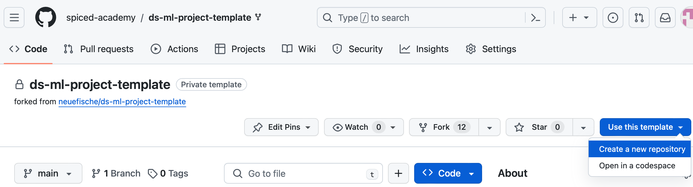

2. Erstelle ein neues Repository mit einem passenden Namen. Owner sollte dein eigenes Konto sein.
   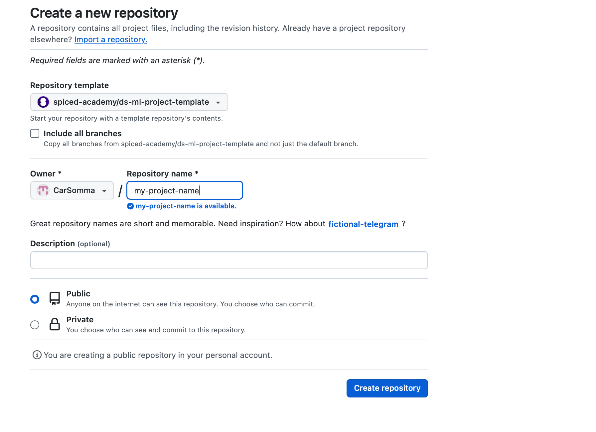

## 2. Das Kanban-Board erstellen

1. Gehe in deinem neuen Repository zu „Projects“ und klicke auf „Link a project“ (der blaue Button). Wenn du noch kein Projekt angelegt hast, erstelle über die Pfeil-Navigation eines in deinem Profil. Du kannst dieses Projekt am Ende zu deinem Repository hinzufügen.
   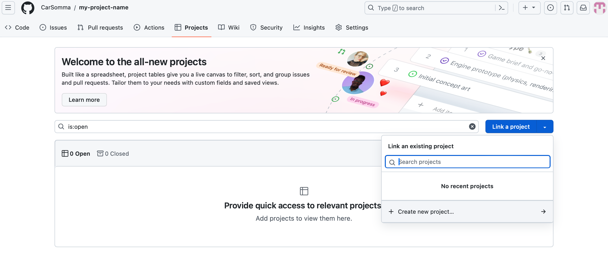

2. Du landest bei den Projekten deines Profils und siehst ein Fenster „create project“. Wähle die Ansicht „Board“, nicht „Table“.
   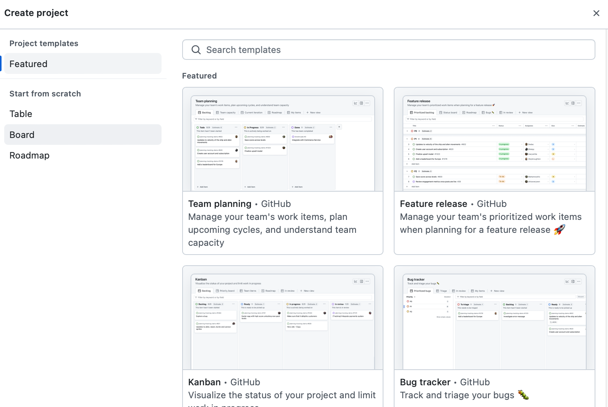

3. Ändere den Namen deines Boards passend zu eurem gewählten ML-Projekt und klicke dann auf den blauen Button „Create project“. Damit hast du ein Kanban-Board erstellt.
   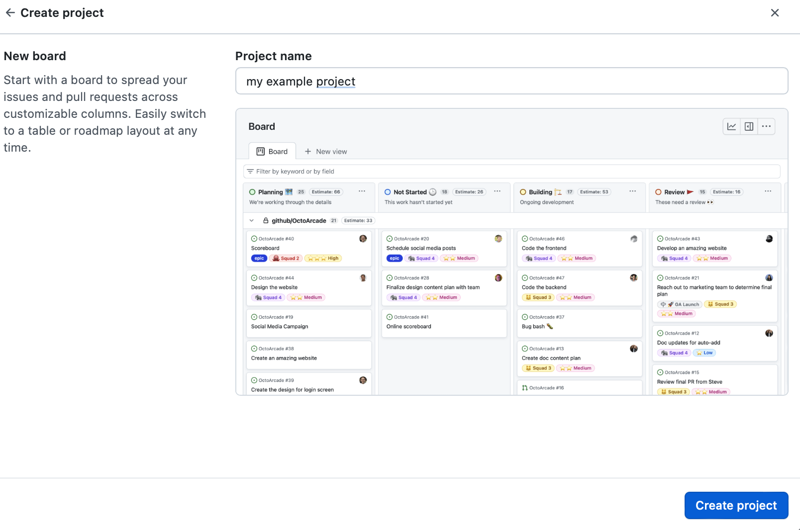

## 3. Dem Team Zugriff geben

1. Klicke oben rechts im Board auf die drei Punkte und gehe zu „Settings“.
   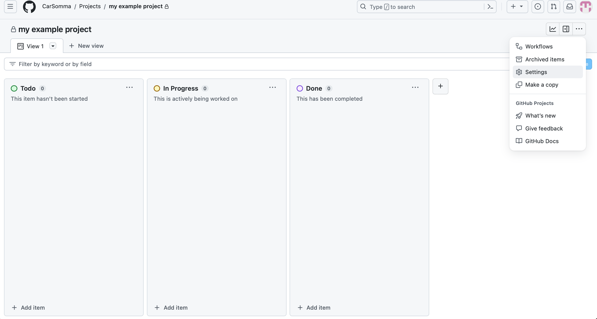

2. Klicke auf „Manage access“. Füge deine Teammitglieder hinzu, indem du nach ihrem GitHub-Namen suchst. Ändere ihre Rolle von „Write“ auf „Admin“ und klicke dann auf den blauen Button „Invite“. Wiederhole das für alle Teammitglieder.
   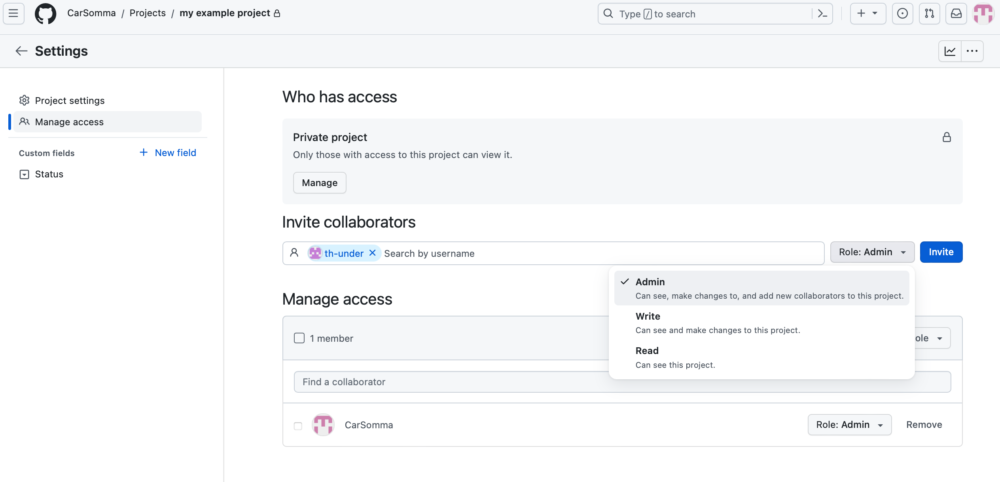

## 4. Aufgaben als Issues hinzufügen

1. Gehe zurück zum Kanban-Board und füge unten Aufgaben mit passenden Namen hinzu, zum Beispiel „load data“ oder „get statistics“.
   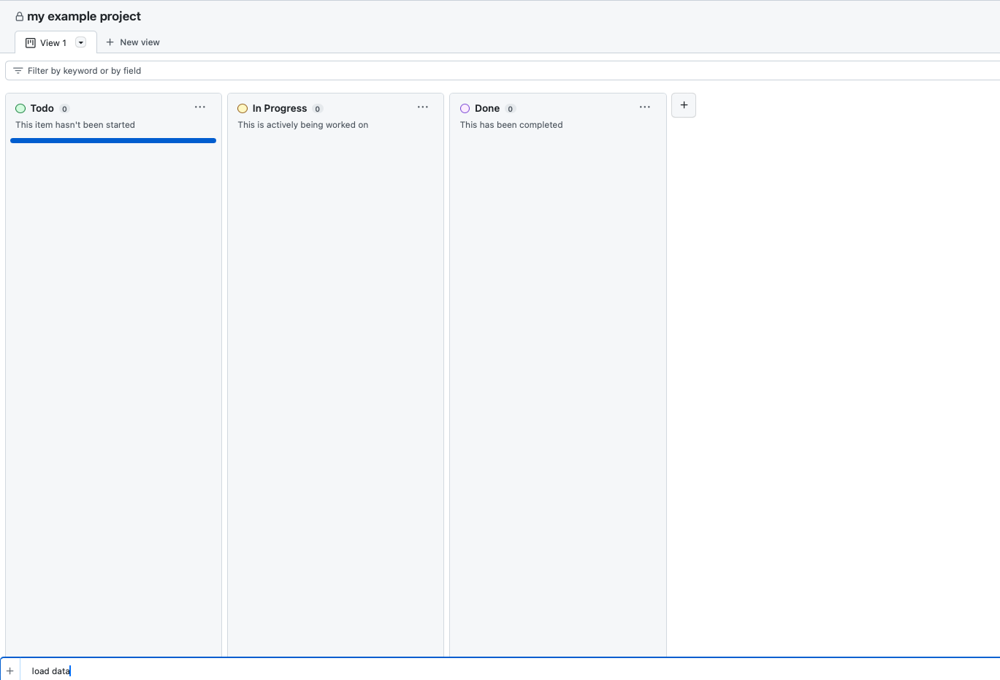

2. Wandle eine hinzugefügte Aufgabe in ein Issue um, indem du auf die drei Punkte bei dieser Aufgabe klickst.
   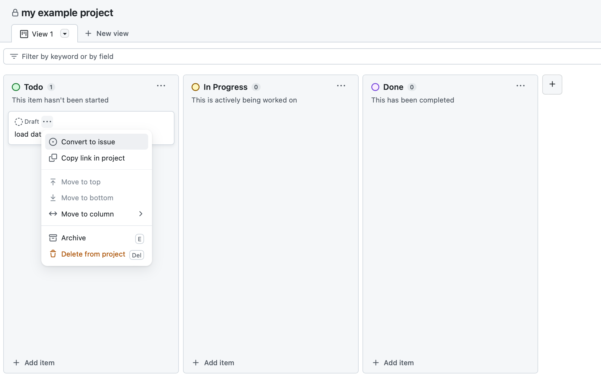

3. Wähle das Repository aus, das du erstellt hast, damit das Issue dort angelegt wird (zum Beispiel „my-project-name“).
   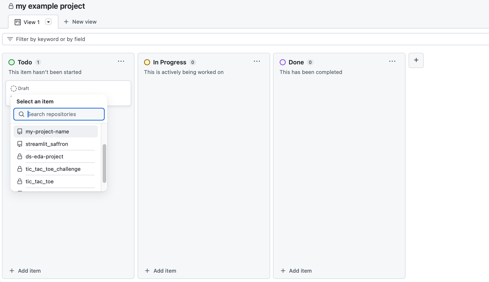

## 5. Meilensteine anlegen

1. Gehe in deinem Projekt-Repository zu „Issues“ und dann zu „Milestones“.
   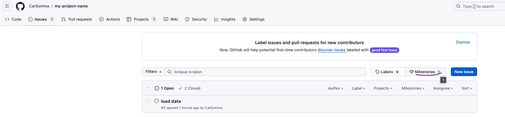

2. Klicke auf „New milestone“.

3. Gib dem Meilenstein ein Fälligkeitsdatum und eine Beschreibung, nach dem Beispiel der Coaches. Die Beschreibung sollte enthalten:

   A) Was erledigt sein muss, damit der Meilenstein abgeschlossen ist.

   B) Die Definition of Done: wie euer Ergebnis aussieht, wenn der Meilenstein abgeschlossen ist (siehe das vorgegebene Format).
   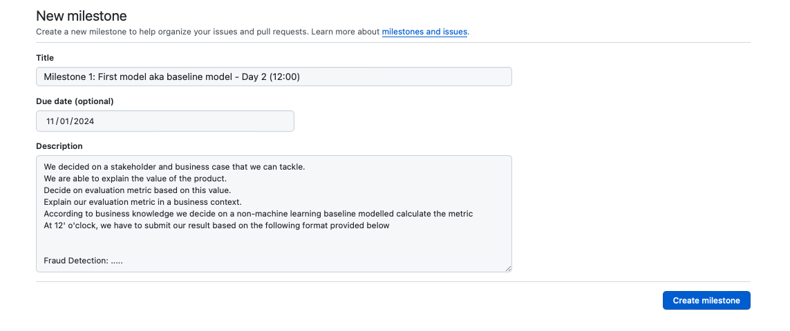

## 6. Issues mit Meilensteinen und Personen verknüpfen

1. Gehe zu „Issues“.

2. Ordne die Issues Meilensteinen zu.
   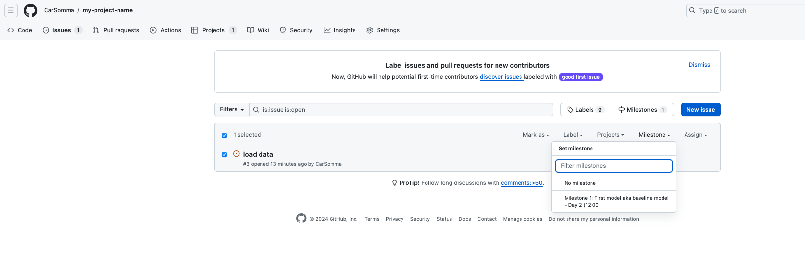

3. Gib jedem Issue Assignees (die Personen, die an der Aufgabe arbeiten).
   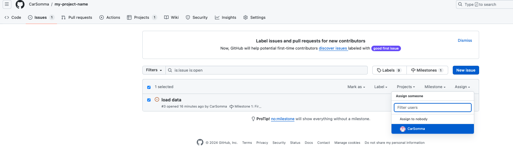

## Optional: Workflows hinzufügen

Workflows können helfen, euer Kanban-Board automatisch auf dem aktuellen Stand zu halten.

1. Wähle das Projekt aus, das du in den Schritten oben erstellt hast.
2. Klicke ganz rechts im Board auf die drei Punkte.
3. Wähle als erste Option „Workflows“.
4. Aktiviere die, die du für euer Projekt sinnvoll findest.
5. Gehe zurück zu deinem Projekt-Repository.
