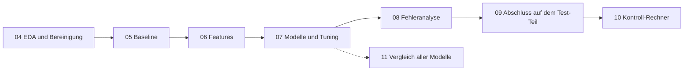

# Betrugserkennung bei Strom und Gas

**Team 5: Roland, Leo, Tobias** · ML-Projekt im Data-Science- und KI-Bootcamp von neue fische

Die tunesische Energiegesellschaft **STEG** verliert Geld durch Kunden, die ihre Zähler manipulieren. Wir sagen für jeden Kunden vorher, wie wahrscheinlich er betrügt. So kann STEG ihre Kontrolleure gezielt zu den verdächtigsten Kunden schicken, statt zufällig zu kontrollieren.

Die Daten (Kunden und ihre Rechnungen) stammen aus der Zindi-Challenge [Fraud Detection in Electricity and Gas Consumption](https://zindi.africa/competitions/fraud-detection-in-electricity-and-gas-consumption-challenge).

## Ergebnis in Kürze

| | Baseline (logistische Regression) | Bestes Modell (Random Forest) |
|---|---|---|
| ROC-AUC Cross-Validation (Train-Teil) | 0,804 | **0,847** |
| ROC-AUC Test-Teil | 0,805 | **0,841** |
| Gefundene Betrüger, wenn man die verdächtigsten 10 % kontrolliert (Test) | 37 % | **46 %** |
| Trefferquote in diesen 10 % (Test) | 20,5 % | **25,8 %** (zufällig: 5,6 %) |

* Das Modell findet bei **10 % der Kontrollen fast die Hälfte aller Betrüger**. Jede vierte Kontrolle ist ein Treffer, ohne Modell nur jede achtzehnte.
* Cross-Validation und Test-Teil liegen fast gleich. Das Modell funktioniert also auch bei neuen Kunden.
* **Einschränkung:** Das wichtigste Feature ist die Anzahl der Zähler (`n_counters`). Wird ein Zähler oft erst *nach* dem Erwischen getauscht, wäre das teilweise Leakage. Ohne dieses Feature liegt die ROC-AUC bei 0,79. Die Wahrheit liegt also zwischen 0,79 und 0,85 (siehe `08_fehleranalyse`).
* **Wirtschaftlich:** Mit geschätzt 25 € pro Kontrolle und 150 € pro gefundenem Betrug lohnt es sich, die verdächtigsten **8 bis 10 %** zu kontrollieren. Zufällige Kontrollen machen bei diesen Werten Verlust (siehe `10_wirtschaftlichkeit`).
* Ein Vergleich aller Klassifikations-Modelle aus dem Kurs zeigt: Kein anderes Modell ist spürbar besser als der Random Forest (siehe `11_alle_modelle`).

## Ablauf



| Notebook | Inhalt | Erzeugt |
|---|---|---|
| [04_eda](04_eda.ipynb) | Daten laden, bereinigen, Train/Test-Split (80/20, stratifiziert), Betrug und kein Betrug im Vergleich | `data/fd_split.csv`, `data/fd_cleaned.csv` |
| [05_baseline](05_baseline.ipynb) | Einfache Baselines bis zur logistischen Regression (ROC-AUC 0,80) | `models/fd_baseline.joblib` |
| [06_features](06_features.ipynb) | Neue Features aus den Rechnungen: Verbrauch pro Monat, Sprünge, Trend, Schwankung, Ablese-Bemerkungen | `data/fd_features.csv` |
| [07_modelle](07_modelle.ipynb) | Logistische Regression, Random Forest und AdaBoost im Vergleich, Tuning des Random Forest | `models/fd_best_model.joblib`, `models/cv_ergebnisse.csv` |
| [08_fehleranalyse](08_fehleranalyse.ipynb) | Schwelle, Konfusionsmatrix, welche Betrüger übersehen werden, Feature-Wichtigkeit, Leakage-Check `n_counters` | |
| [09_abschluss](09_abschluss.ipynb) | Einziger Einsatz des Test-Teils: Baseline gegen bestes Modell, ROC-Kurve, Top 10 % | |
| [10_wirtschaftlichkeit](10_wirtschaftlichkeit.ipynb) | Kontroll-Rechner: Wie viele Kunden soll STEG kontrollieren? Mit Gewinnkurve und Szenarien | |
| [11_alle_modelle](11_alle_modelle.ipynb) | Zusatz: alle Klassifikations-Modelle aus dem Kurs unter gleichen Bedingungen | |

**Gemeinsame Regeln für alle Modell-Notebooks** stehen in [`fd_utils.py`](fd_utils.py): dieselben 5 Folds, dieselben Metriken (ROC-AUC, Recall, Precision) und die Top-10-%-Auswertung.

### Warum ROC-AUC?

Nur 5,6 % der Kunden sind Betrüger. Die Accuracy wäre deshalb irreführend: „Immer kein Betrug“ hätte schon 94 %. Die ROC-AUC bewertet, wie gut das Modell die Kunden **nach Verdacht sortiert**. Genau das braucht STEG, um die Kontrollen zu planen. Zusätzlich messen wir, wie viele Betrüger man in den verdächtigsten 10 % findet.

## Projekt ausführen

Voraussetzung: [uv](https://docs.astral.sh/uv/getting-started/installation/) 0.13.5 oder neuer. Die Python-Version steht in [`.python-version`](.python-version).

**1. Repository klonen und Umgebung installieren**

```bash
git clone git@github.com:tkruse90/ds-ml-fraud-detection.git
cd ds-ml-fraud-detection
uv sync
```

**2. Rohdaten entpacken**

`data/train.zip` per Doppelklick entpacken. Danach gibt es `data/train/client_train.csv` und `data/train/invoice_train.csv`. Die entpackten CSV-Dateien landen wegen `.gitignore` nicht auf GitHub.

**3. Notebooks der Reihe nach ausführen**

In VS Code den Projektordner öffnen (`code .`) und als Kernel die Umgebung aus `.venv` wählen. Dann die Notebooks in dieser Reihenfolge ausführen:

`04` → `05` → `06` → `07` → `08` → `09` → `10` → `11`

* Jedes Notebook braucht die Dateien, die die vorherigen erzeugen (siehe Tabelle oben).
* `07_modelle` dauert wegen des Tunings etwa 10 Minuten, `11_alle_modelle` deutlich länger.
* Der Train/Test-Split ist in `data/fd_split.csv` gespeichert. `04_eda` überschreibt ihn nicht, alle bekommen also dieselben Ergebnisse.

## Ordner und Dateien

| Datei / Ordner | Inhalt |
|---|---|
| `data/` | `train.zip` (Rohdaten) und `fd_split.csv` (Train/Test-Split). Die übrigen CSV-Dateien erzeugen die Notebooks, sie sind nicht auf GitHub. |
| `models/` | Gespeicherte Modelle und CV-Ergebnisse. Sie werden von den Notebooks erzeugt und sind nicht auf GitHub. |
| `fd_utils.py` | Gemeinsame Bewertungsfunktionen |
| `pyproject.toml`, `uv.lock` | Abhängigkeiten |
| `01_assignment.md`, `02_kanban_board.md`, `03_eda-and-modeling.ipynb`, `assets/` | Aufgabenstellung und Material aus der Bootcamp-Vorlage |

## Merge-Konflikte in Notebooks

Führen zwei Personen dasselbe Notebook neu aus, entstehen Konflikte in den Ausgaben (vor allem in Bildern). Das Tool `nbdime` hilft dabei:

```bash
uvx nbdime config-git --enable
uvx nbdime mergetool
```
