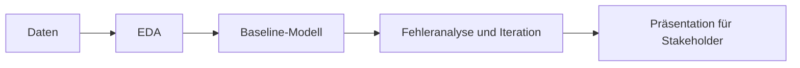

# Vorlage für ein Machine-Learning-Projekt

Ein Ausgangspunkt für euer Team-Projekt im Machine Learning. Das Repository enthält ein Beispiel-Notebook, das mit minimaler Bereinigung und Feature-Auswahl ein einfaches Modell trainiert. Nutze es als Gerüst und baue darauf dein eigenes Projekt auf.

Das Beispiel verwendet den [Coffee-Quality-Datensatz](https://github.com/jldbc/coffee-quality-database).

## Lernziele

Am Ende dieses Repositorys solltest du Folgendes können:

- Im Team an einem Data-Science-Projekt arbeiten und die Arbeit über den gesamten Data-Science-Lebenszyklus aufteilen.
- Ein Geschäftsproblem als Machine-Learning-Aufgabe formulieren und eine Bewertungsmetrik wählen, die zum angestrebten Nutzen passt.
- Ein Baseline-Modell bauen und es dann mit Fehleranalyse und mindestens drei Algorithmen weiterentwickeln (einschließlich Cross-Validation und Hyperparameter-Tuning).
- Deine Ergebnisse und Empfehlungen in einer kurzen Präsentation einem nicht-technischen Publikum vermitteln.

## Lernpfad

Dein Projekt folgt dem Data-Science-Lebenszyklus:



Beginne mit der Aufgabenstellung, richte dein Board ein und nutze dann das Beispiel-Notebook als Vorlage:

| Datei / Ordner | Beschreibung |
|---|---|
| [**Aufgabenstellung**](01_assignment.md) | Das Projekt-Briefing: Zeitplan, Meilensteine, Projektoptionen, Abgaben und Punkte, über die du nachdenken solltest. |
| [**Kanban-Board**](02_kanban_board.md) | Schritt-für-Schritt-Einrichtung eines GitHub-Projektboards, um eure Arbeit zu planen und zu verfolgen. |
| [**EDA und Modellierung**](03_eda-and-modeling.ipynb) | Ausgearbeitetes Beispiel: Features auswählen, minimal bereinigen und ein einfaches Modell trainieren. |

### Weitere Ordner und Dateien

| Datei / Ordner | Beschreibung |
|---|---|
| [**Daten**](data/) | Hier kommen eure Datensätze hin. |
| [**Modelle**](models/) | Hier werden trainierte Modelle gespeichert. |
| [**Assets**](assets/) | Screenshots für die Anleitung zum Kanban-Board. |
| [**pyproject.toml**](pyproject.toml) | Projektkonfiguration und Abhängigkeiten. |
| [**uv.lock**](uv.lock) | Lock-Datei mit den genauen Paketversionen. |

## Einrichtung

Verwende [uv](https://docs.astral.sh/uv/getting-started/installation/) 0.13.5 oder neuer
und Python 3.13.17 oder eine neuere 3.13-Patch-Version, wie in
[`.python-version`](.python-version) festgelegt.

> [!NOTE]
> In diesen Schritten ist Text in spitzen Klammern wie `<repo-name>` ein **Platzhalter**. Ersetze ihn, samt den Klammern `< >`, durch deinen eigenen Wert. Aus `cd <repo-name>` wird zum Beispiel `cd my-ml-project`.

### 1. Repository aus der Vorlage erstellen

Klicke auf GitHub auf **Use this template**.

Beim Erstellen des Repositorys:

- Trag dich selbst als **Owner** ein
- Wähle einen Namen für das Repository
- Deaktiviere **Include all branches**
- Klicke auf **Create repository**

> [!IMPORTANT]
> Wenn ihr zu zweit oder in Gruppen arbeitet, erledigt diesen Schritt nur **eine Person**.

---

### 2. Mitwirkende hinzufügen (nur bei Paaren/Gruppen)

Wenn du mit anderen zusammenarbeitest:

1. Öffne das Repository auf GitHub
2. Gehe zu **Settings → Collaborators**
3. Füge deine Teammitglieder als Collaborators hinzu
4. Teile den Link zum Repository mit deinem Team

Die Teammitglieder sollten die Einladung annehmen, bevor es weitergeht.

---

### 3. Repository klonen

Kopiere die SSH-URL über den Button **Code** auf GitHub und führe dann aus:

```bash
git clone <kopierte-ssh-url>
```

Die kopierte SSH-URL sieht so aus: `git@github.com:<dein-benutzername>/<repo-name>.git`.

---

### 4. In den Projektordner wechseln und Abhängigkeiten installieren

Das installiert alle Abhängigkeiten und legt eine virtuelle Umgebung in `.venv/` an.

```bash
cd <repo-name>
uv sync
```

> [!TIP]
> Das ist euer eigenes Projekt, ihr werdet also nach und nach Bibliotheken hinzufügen. Ein neues Paket installierst du mit `uv add <paket>` (zum Beispiel `uv add xgboost`). Das aktualisiert `pyproject.toml` und `uv.lock` für das ganze Team.

---

### 5. Notebook öffnen

> [!NOTE]
> Öffne VS Code unbedingt im Hauptordner des Projekts, damit es die von `uv sync` erstellte Umgebung automatisch erkennt.

Starte VS Code im Hauptordner des Projekts:

```bash
code .
```

Öffne dann `03_eda-and-modeling.ipynb` und wähle die von `uv sync` erstellte Python-Umgebung als Kernel.

## Merge-Konflikte in Notebooks lösen

Bei der Arbeit im Team können `.ipynb`-Dateien unübersichtliche Merge-Konflikte verursachen, weil sie auf JSON basieren. Das Tool `nbdime` macht das einfacher, und `uvx` führt es aus, ohne es zu den Abhängigkeiten deines Projekts hinzuzufügen.

Aktiviere die Git-Integration einmalig:

```bash
uvx nbdime config-git --enable
```

Wenn ein Konflikt auftritt, öffne das Merge-Tool:

```bash
uvx nbdime mergetool
```

Es öffnet sich eine Weboberfläche, die beide Notebook-Versionen nebeneinander zeigt. Wähle aus, was du behalten willst, speichere, schließe das Tool und führe dann aus:

```bash
git add your_notebook.ipynb
git commit -m "Resolve notebook conflict"
```

> [!TIP]
> Bei der Arbeit mit Notebooks ist es sinnvoll, vor dem Committen die Ausgaben zu löschen. So sinkt die Gefahr von Konflikten. In VS Code geht das über die Befehlspalette: `Notebook: Clear All Outputs`.

## Quellen und weiterführende Literatur

Die externen Ressourcen sind auf Englisch.

- [**scikit-learn-Dokumentation**](https://scikit-learn.org/stable/): die Bibliothek für die Modellierung, mit Benutzerhandbüchern und Beispielen.
- [**Choosing the Right Estimator**](https://scikit-learn.org/stable/machine_learning_map.html): eine grafische Übersicht, um je nach Problem und Daten ein Modell auszuwählen.
- [**PEP 8: Styleguide für Python-Code**](https://peps.python.org/pep-0008/): der Stil, dem dein Notebook folgen sollte.
- [**Jupyter Notebooks in VS Code**](https://code.visualstudio.com/docs/datascience/jupyter-notebooks): wie man in VS Code Notebooks ausführt und einen Kernel auswählt.
- [**uv-Dokumentation**](https://docs.astral.sh/uv/): der Paketmanager, der Python und die Abhängigkeiten dieses Repositorys verwaltet.
- [**Zindi Competitions**](https://zindi.africa/competitions): Aufgaben aus der Praxis. Mehrere davon stehen in der Aufgabenstellung als Projektoptionen.
